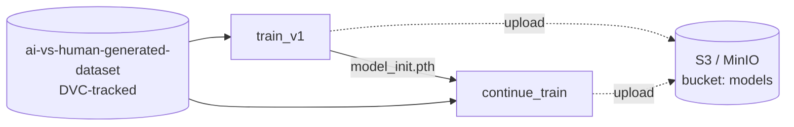

# AI vs Human Image Classifier — MLOps Pipeline

A binary image classifier that tells AI-generated images from human-made ones, wrapped in a reproducible MLOps workflow: versioned data, a DVC pipeline, experiment tracking in TensorBoard and model artifacts stored in S3 (MinIO).

## Overview

The project simulates a model's lifecycle when new data arrives:

1. **Base training:** an ImageNet-pretrained ResNet18 with a new 2-class head is trained on `Train_1` and evaluated on `Test_1`.
2. **Fine-tuning:** the base model is trained further on a new batch of data (`Train_2`) and evaluated on `Test_2`.
3. Each model version is saved locally, uploaded to S3, and its test metrics are tracked by DVC, so versions can be compared side by side.

## Tech stack

| Area | Tools |
|---|---|
| Model | PyTorch, torchvision (ResNet18) |
| Pipeline and data versioning | DVC |
| Experiment tracking | TensorBoard |
| Artifact and data storage | MinIO (S3-compatible), boto3 |
| Infrastructure | Docker Compose |

## Pipeline



| Stage | Command | Data | Output | Metrics |
|---|---|---|---|---|
| `train_v1` | `python train.py` | `Train_1` / `Test_1` | `logs/artifacts/init_model/model_init.pth` | `logs/artifacts/init_model/metrics_v1.json` |
| `continue_train` | `python continue_train.py` | `Train_2` / `Test_2` | `logs/artifacts/continue_train/model_v2.pth` | `logs/artifacts/continue_train/metrics_v2.json` |

DVC tracks the code, parameters and data behind each stage, so `dvc repro` reruns only the stages affected by a change.

## Project structure

```
.
├── train.py                            # stage 1: base training + evaluation + upload to S3
├── continue_train.py                   # stage 2: fine-tuning the base model + evaluation + upload to S3
├── utils.py                            # dataset, transforms, model setup, train/eval loops, S3 upload
├── params.yaml                         # hyperparameters and data paths for both stages
├── dvc.yaml                            # DVC pipeline definition
├── ai-vs-human-generated-dataset.dvc   # DVC pointer to the dataset
├── train_model.ipynb                   # interactive walkthrough of base training
└── docker-compose.yml                  # local MinIO
```

## Getting started

### 1. Install dependencies

```bash
pip install torch torchvision tensorboard "dvc[s3]" boto3 pandas scikit-learn pillow tqdm pyyaml
```

### 2. Start MinIO

```bash
docker compose up -d
```

The MinIO console is at http://localhost:9001 (`minioadmin` / `minioadmin`).

> **Port note:** `utils.py` and `.dvc/config` expect the S3 API at `http://localhost:6062`, but `docker-compose.yml` publishes it on `9000`. Either change the port mapping to `"6062:9000"`, or point both settings at `9000`.

### 3. Pull the dataset

```bash
dvc pull
```

### 4. Run the pipeline

```bash
dvc repro          # run all stages that are out of date
dvc dag            # print the pipeline graph
dvc metrics show   # compare test metrics of both model versions
```

### 5. Inspect training runs

```bash
tensorboard --logdir logs/runs
```

## Experiment tracking

| What | Where |
|---|---|
| Train loss, accuracy, F1 (each epoch) | TensorBoard: `logs/runs/<exp_name>` |
| Test loss, accuracy, F1, precision, recall | TensorBoard + `logs/artifacts/<exp_name>/metrics_v*.json` (DVC metrics) |
| Model weights | `logs/artifacts/<exp_name>/` and `s3://models/<exp_name>/` |

## Configuration

All settings are in `params.yaml`:

- `train`: experiment name, `Train_1`/`Test_1` paths, epochs, batch size, learning rate.
- `continue_train`: path to the base weights, `Train_2`/`Test_2` paths, number of extra epochs, starting epoch (keeps the TensorBoard step axis continuous), batch size, learning rate.

Change any value and run `dvc repro`. Only the affected stages rerun.

## Dataset

The dataset is versioned with DVC and stored in the MinIO remote (`s3://models`). Layout:

```
ai-vs-human-generated-dataset/
├── Train_1/  train.csv + images
├── Test_1/   test.csv  + images
├── Train_2/  train.csv + images
└── Test_2/   test.csv  + images
```

Each CSV has a `file_name` column (image path relative to the split folder) and a `label` column (binary class, 0 or 1).
